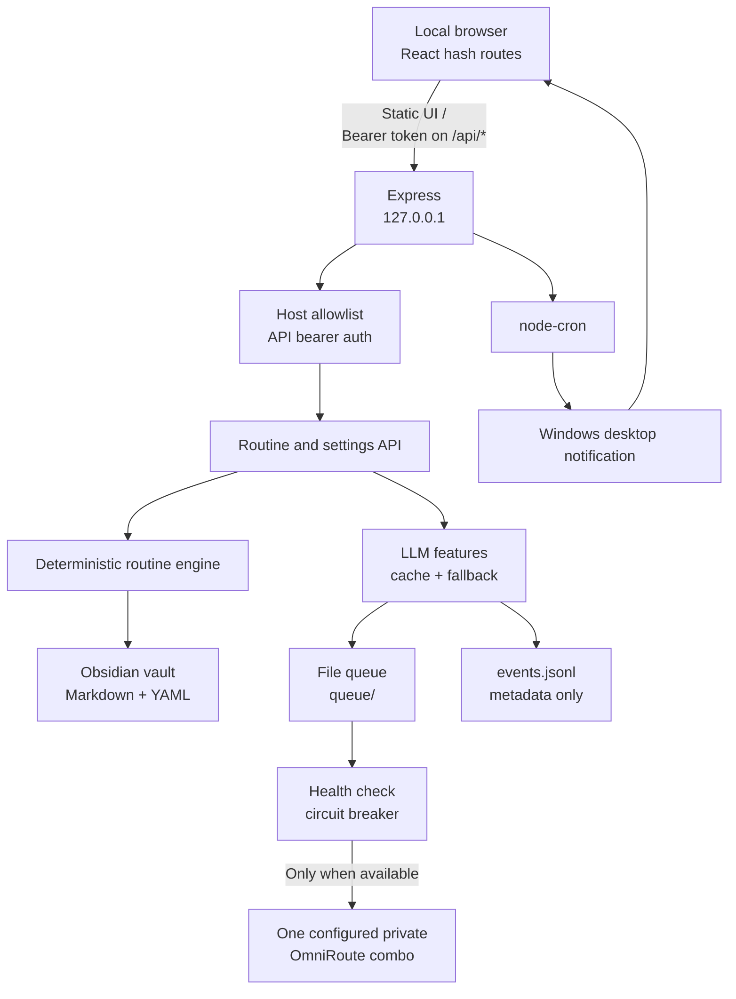
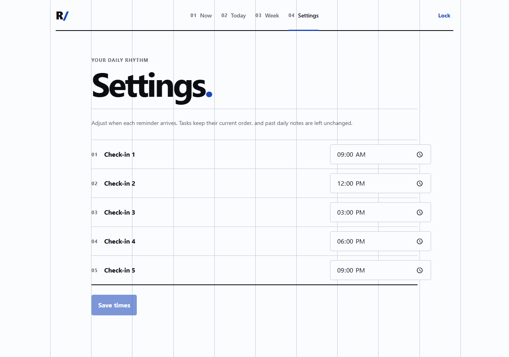
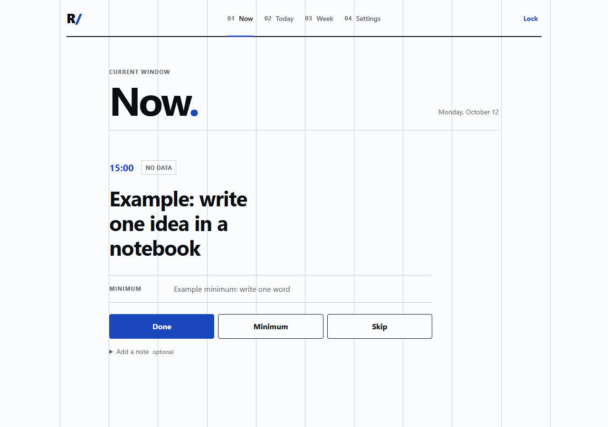

# Personal Routine Assistant

A local-first routine tracker for Windows. It presents the current check-in, records Done / Minimum / Skip in an Obsidian-compatible vault, and schedules Windows notifications. The React UI and deterministic routine rules work without an LLM; optional private-model work is queued for a single explicitly configured OmniRoute combo.

## What it does

- Shows the current task and its minimum version, with a fast status check-in.
- Shows today's five routine windows and a weekly consistency summary.
- Lets you change reminder times without renaming task windows or rewriting old daily notes.
- Sends scheduled desktop notifications that open the relevant UI page.
- Saves daily logs and notes as Markdown in your vault.
- Serves deterministic nudges/reviews when the desktop model is offline; queues optional commentary for later.

## Requirements

- Windows 10/11
- Node.js 20 or 22 LTS and npm
- An Obsidian vault folder (the app creates its `Daily` and `Routine` subfolders as needed)
- Optional: OmniRoute configured to route the private combo exclusively to your desktop model

## Setup on Windows

Open PowerShell in the cloned project folder:

```powershell
npm install
Copy-Item .env.example .env
```

Edit `.env`:

1. Set `API_TOKEN` to a long random value that you keep private.
2. Set `VAULT_PATH` to your real Obsidian vault directory.
3. Keep `OMNIROUTE_PRIVATE_COMBO` empty until the named combo has been checked to contain only your desktop model. `OMNIROUTE_KEY` is optional for a local gateway.

Create the routine file in your vault by copying the synthetic example, then edit it to suit your routine:

```powershell
New-Item -ItemType Directory -Force "$env:VAULT_PATH\Routine" | Out-Null
Copy-Item .\sample-vault\Routine\routine.yaml "$env:VAULT_PATH\Routine\routine.yaml"
```

Build and start the app:

```powershell
npm start
```

Open `http://127.0.0.1:3737/`. Enter the API token when prompted; it is held in this browser tab's session storage. The server listens on loopback and `npm start` builds the UI before launching Express.

The scheduled `Personal API` Windows Task Scheduler entry can start the same `npm start` command at logon. Its working directory must be the project root. Desktop notifications depend on Windows notification settings and the laptop being awake.

## Configuration

| Variable | Required | Purpose |
| --- | --- | --- |
| `API_TOKEN` | Yes | Bearer token for every `/api/*` endpoint |
| `VAULT_PATH` | Yes | Root folder of the local Obsidian vault |
| `PORT` | No | HTTP port; defaults to `3737` |
| `ALLOWED_HOSTS` | No | Comma-separated Host allowlist; defaults to loopback names |
| `OMNIROUTE_URL` | No | One OmniRoute OpenAI-compatible base URL; defaults to local port `20128` |
| `OMNIROUTE_PRIVATE_COMBO` | No | The only model/combo the app may call; absent means LLM processing stays disabled |
| `OMNIROUTE_KEY` | No | Optional credential for that local OmniRoute endpoint |

The application has no alternate provider, model, or cloud fallback. The project cannot verify that an OmniRoute combo is desktop-only; verify that in OmniRoute before setting `OMNIROUTE_PRIVATE_COMBO`. Real desktop-model integration has not been exercised by the automated tests.

## HTTP API

All `/api/*` requests require `Authorization: Bearer <API_TOKEN>`. `/health` is open. The static UI at `/` is public but contains no routine or vault data.

| Method | Path | Description |
| --- | --- | --- |
| `GET` | `/health` | Liveness check |
| `GET` | `/api/now` | Current routine window and task |
| `POST` | `/api/log` | Save a `done`, `minimum`, or `skip` status; optional note |
| `GET` | `/api/today` | Today's five tasks and statuses |
| `GET` | `/api/week` | Weekly template, focus and consistency |
| `GET` | `/api/settings` | Read the five reminder times |
| `PUT` | `/api/settings` | Save five unique, chronological `HH:mm` reminder times |
| `GET` | `/api/nudge/:window` | Cached or deterministic nudge |
| `POST` | `/api/notes` | Save a note immediately and queue reflection |
| `GET` | `/api/review/week` | Deterministic review, with optional later model commentary |
| `GET` | `/api/suggestions` | Pending template suggestions; never applied automatically |

Example log request:

```powershell
$headers = @{ Authorization = "Bearer $env:API_TOKEN" }
Invoke-RestMethod -Uri "http://127.0.0.1:3737/api/now" -Headers $headers
```

## Data and privacy

- `VAULT_PATH\Routine\routine.yaml` contains the routine template.
- `VAULT_PATH\Routine\check-in-times.json` stores the editable reminder schedule separately. The routine window keys remain stable, so history is not migrated when times change.
- `VAULT_PATH\Daily\YYYY-MM-DD.md` stores check-in logs and notes; weekly reviews are written under `Routine\Reviews`.
- `queue\` contains local durable LLM jobs and cache data. A queued reflection includes its note text, so keep the project folder private.
- `events.jsonl` records model/fallback/queue metadata, never prompt or note text.
- `.env`, `vault\`, `queue\`, build output and `events.jsonl` are ignored by Git. `sample-vault\` is deliberately tracked and contains synthetic demo data only.
- The server binds to loopback by default, validates the Host header, and makes no CORS configuration or external font/script requests.

## Architecture



## Tradeoffs

- Markdown/YAML keeps data readable and portable without a database; writes are local files rather than transactions.
- A fixed set of five ordered windows keeps check-ins predictable. Editable times move reminders, not task identities.
- A local file queue survives restarts but is single-user/single-process storage, not a distributed job system.
- The app remains useful with the model off. Model commentary is delayed, limited by a three-attempt queue cap, and never controls routine rules.
- Localhost-only access and a tab-scoped token prioritize privacy over multi-device access and persistent sign-in.

## Tests

Install dependencies and configure `.env` first, then run:

```powershell
npm test
```

This builds the production UI and runs Vitest. The tests use fake LLM clients and temporary vaults/sample fixtures; they do not make real OmniRoute calls. Coverage includes authentication, routine rules, schedule persistence/rescheduling, UI/API integration, queue recovery, model-off fallbacks, output validation, and note-text redaction from events.

Most recent `npm test`: production build passed; **61 tests passed across 11 files** (2026-10-12). The real desktop model/combo remains to be verified manually.

## Screenshots

Captured from the local demo using only the synthetic sample routine:



